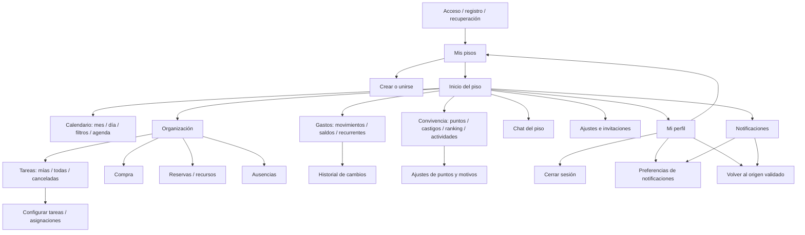

# Auditoría UI/UX de RoomieHub

Base: `03441d2`. Diagnóstico inicial guardado antes de modificar la interfaz. Producto web/PWA, no cliente Android nativo. Cuenta de desarrollo y backend reales; no se crean datos para ilustrar las capturas. Los cambios previos de menús se conservan y sirven de base.

## Método y alcance

- Lectura de requisitos, AGENTS.md, rutas, componentes, estilos, contratos y auditorías previas.
- Compilación de producción e inicio de sesión real con las variables seguras existentes.
- Capturas autenticadas de 24 destinos en 1440 px y 390 px; comprobaciones adicionales de Inicio, Tareas, Gastos, Chat y Perfil en 768 y 320 px. Claro y oscuro se fijan **después** de iniciar sesión porque el login restaura las preferencias del perfil.
- Revisión visual independiente A de Impeccable y revisión mecánica B separada, con hallazgos sintetizados. No investigación con participantes ni prueba física de Android.
- Criterio de evidencia: demostrado por interfaz/código/medida, hipótesis de integración o preferencia de acabado. Los tiempos de capturas incluyen red, navegación y captura: no son benchmarks de producción.

## Inventario y navegación que se preserva

Las 24 pantallas/estados auditados son: Mis pisos; Inicio; Tareas; Configurar tareas; Compra; Ausencias; Reservas; Calendario; Movimientos; Saldos; Recurrentes; Historial de gastos; Puntos; Castigos; Ranking; Ajustes de puntos; Actividades; Chat; Ajustes del piso; Perfil; Notificaciones; Preferencias de notificaciones; Crear piso; Unirse. También se mantienen los recorridos públicos de acceso/registro/recuperación y sus pruebas existentes.

## Fortalezas

- Navegación persistente y rotulada, agrupación por tareas reales y configuración secundaria identificable.
- Links profundos, historial del calendario y retornos de cuenta conservan contexto; no se sustituyen por menús nuevos.
- Backend real y estados financieros exactos. Formularios con pending, valores retenidos y feedback; confirmaciones destructivas y anonimato.
- Identidad verde reconocible, temas claro/oscuro y fuentes del sistema sin dependencia de red.

## Hallazgos priorizados antes de implementar

| ID    | Gravedad / evidencia                         | Problema y reproducción                                                                                                                                                                                      | Consecuencia                                                                                         | Corrección prevista                                                                                                                                                    | Impacto / esfuerzo / riesgo                          |
| ----- | -------------------------------------------- | ------------------------------------------------------------------------------------------------------------------------------------------------------------------------------------------------------------ | ---------------------------------------------------------------------------------------------------- | ---------------------------------------------------------------------------------------------------------------------------------------------------------------------- | ---------------------------------------------------- |
| UX-01 | P1, demostrado                               | En Tareas hay 54 tarjetas; una tarea de septiembre aparece antes de las actuales aunque el filtro Desde diga octubre. El periodo solo se ve al abrir Detalles. Nombres y botones se repiten indistinguibles. | Es difícil elegir la ocurrencia correcta antes de marcarla hecha.                                    | Periodo visible siempre, explicación de pendientes anteriores, agrupación por periodo y filas más compactas. Mantener todas las instancias, consulta, fechas y acción. | Alto / medio / bajo si se conservan IDs y contratos. |
| UX-02 | P1, demostrado                               | En el chat vacío a 390×844, el log mide 438 px, el compositor empieza en y≈739 y la navegación en y≈775.                                                                                                     | La interfaz invita a conversar pero el campo y Enviar requieren desplazamiento adicional.            | Log vacío de altura natural, mensaje compacto y compositor inmediatamente después. No mostrar paginación sin mensajes; conservarla cuando haya historial.              | Alto / bajo / bajo.                                  |
| UX-03 | P2, demostrado                               | En Puntos, cinco métricas, explicación de historial y reglas preceden a Valorar, que queda fuera del primer viewport móvil. La explicación completa se usa como summary.                                     | La acción principal está enterrada y los conceptos contables tienen el mismo peso que el saldo útil. | Valorar antes del detalle; disponibles/negativos como resumen principal, otros contadores e histórico plegables con título breve. Mantener todos los valores y reglas. | Alto / medio / bajo.                                 |
| UX-04 | P2, demostrado                               | A 768 px la sidebar ocupa cerca de una cuarta parte del ancho y Mi perfil salta a una segunda fila del topbar.                                                                                               | Tablet recibe una versión de escritorio demasiado estrecha.                                          | Adaptación intermedia con navegación compacta y contenido a ancho útil; conservar las seis etiquetas y el orden.                                                       | Medio / medio / bajo con pruebas de scroll/teclado.  |
| UX-05 | P2, demostrado                               | Inicio repite nombre del piso, etiqueta Inicio, bienvenida, accesos rápidos y directorio de módulos. “La puerta está abierta” enlaza a invitaciones, sin nombrar la acción.                                  | El contenido útil tarda en aparecer; el acceso a invitar resulta ambiguo.                            | Cabecera compacta y neutral, invitación con verbo explícito, directorio secundario compacto, resúmenes personales primero.                                             | Medio / medio / bajo.                                |
| UX-06 | P2, demostrado en capturas                   | Títulos de escritorio de hasta 51 px, paneles grandes con borde/sombra/radio combinados y vacíos equivalentes al contenido.                                                                                  | La densidad dificulta comparar registros y aumenta el scroll.                                        | Escala de títulos de aplicación, tokens de superficie/radio/espaciado coherentes y listas con separación ligera. No eliminar estados o información.                    | Medio / medio / bajo.                                |
| UX-07 | P2, por medir con escáner                    | Algunas áreas de iconos de topbar y detalles de acción parecen menores de 44 px; se comprobarán medidas y contraste en temas/extremos.                                                                       | Posibles errores al tocar o dificultad para leer estados.                                            | Corregir los objetivos/contrastes demostrados; no aplicar cambios de color por preferencia del detector.                                                               | Medio / bajo / bajo.                                 |
| UX-08 | P2, demostrado en código y pantalla          | Calendario muestra al final detalles de implementación (“no genera tareas…”); algunos vacíos y el historial de pagos carecen de siguiente paso/contexto específico.                                          | Más explicación técnica y menos ayuda para completar la tarea.                                       | Mantener la explicación necesaria bajo ayuda breve; estados vacíos concretos con acciones existentes.                                                                  | Medio / bajo / bajo.                                 |
| UX-09 | P3, preferencia justificada por consistencia | Variaciones de padding/radios/fuentes entre componentes y CSS acumulado; iconos decorativos repetidos en el directorio.                                                                                      | Acabado desigual y mantenimiento difícil.                                                            | Consolidar roles de tokens y eliminar variación que no expresa jerarquía.                                                                                              | Bajo / medio / bajo.                                 |

No se ha encontrado un P0. La revisión visual independiente puntúa provisionalmente las heurísticas de Nielsen en 25/40; es una evaluación experta, no una medida de usabilidad con usuarios.

## Investigación y herramientas

- **Impeccable 4.8.0**, fuente oficial `pbakaus/impeccable`, revisión `02523aec3e4c4580102d996d1b6a71fbe062e03f`. Se inspeccionó el shim npm y su verificación de checksums antes de ejecutar el comando oficial, fijando versión. El instalador intentó descargar el bundle desde impeccable.style, bloqueado por la política. Se usó la copia manual oficial para Codex en `~/.agents/skills/impeccable`. Context se ejecutó correctamente. Se seleccionan init/document, audit/critique, distill/layout/typeset, harden/adapt y polish; no se aplican overdrive ni animaciones decorativas. Hooks automáticos no se activan; el detector se ejecuta manualmente.
- **Taste Skill**, fuente oficial `Leonxlnx/taste-skill`, revisión `12af471f627f866411b4bd785b19646d3672784c`. Instalación de la skill `design-taste-frontend` en `~/.agents/skills/`, sin dependencias de aplicación. Se usa `draw.mjs --app --kind workspace --keep palette,type`; se elige editorial-greeting por contexto de hogar/equipo, conservando composición útil y superficies tonales. La navegación, fuentes, datos y objetivos táctiles del producto prevalecen sobre sugerencias genéricas de 32 px, sustituir el shell o inventar un dataset. La dirección queda en `.taste-skill/direction.json` como artefacto local; las decisiones finales viven en DESIGN.md.
- **Vídeo YouTube**: la URL solicitada devuelve bloqueo de proxy 403. No se afirma haberlo visto ni aplicado técnicas no verificadas del vídeo.
- **Figma MCP**: no hay herramientas Figma conectadas ni archivo de diseño aportado. La documentación indicada también está bloqueada. Para usarlo posteriormente: conectar el servidor oficial mediante la integración de Figma compatible con Codex, autorizar la cuenta y facilitar el enlace al archivo y frame. No es requisito para esta entrega y no se alteran credenciales ni autorizaciones.
- **Higgsfield**: web bloqueada y sin integración conectada. No se usan créditos ni se generan imágenes; las pantallas operativas ya tienen contenido real y no necesitan ilustraciones decorativas.
- **Dribbble, Figma Community, Pinterest, Splitwise, Todoist y Flatastic**: se intentó acceder a sus páginas; el proxy deniega esos destinos. No se adjudican referencias visuales no vistas.

### Tres referencias oficiales accesibles

1. [Material Web: Tabs](https://github.com/material-components/material-web/blob/main/docs/components/tabs.md): distinguir jerarquía primaria/secundaria, contenido al mismo nivel y desplazamiento dentro del grupo. Se adapta el principio, sin instalar Material ni copiar pantallas.
2. [GitHub Primer React](https://github.com/primer/react): controles y lenguaje visual consistentes en una aplicación con información densa; jerarquía de acciones y orientación clara. Se consultó el README oficial; no se atribuyen detalles de componentes que no se hayan podido leer.
3. [Radix Navigation Menu](https://github.com/radix-ui/primitives/blob/main/packages/react/navigation-menu/src/navigation-menu.tsx): comportamiento explícito de foco, teclado, aria y retorno al activador. Se adaptan principios de interacción, no la apariencia ni la dependencia.

No son tres tableros de inspiración vistos en plataformas bloqueadas. Son referencias técnicas oficiales accesibles usadas como alternativa, con su alcance declarado.

## Verificación prevista y límites

Antes/después con datos del mismo piso y sin fabricar registros. Web 320/390/768/1440, claro/oscuro, teclado, enlaces profundos, historial, filtros, creación desplegada, extremos y movimiento reducido. Repetir como máximo tres rondas de inspección y corregir los tres problemas principales. Ejecutar lint, tipos, build, lógica/SQL y pruebas públicas/componentes; añadir regresiones específicas para los comportamientos nuevos. No afirmar envíos, pagos o tareas completadas si solo se abre el formulario. No publicar ni consumir servicios de pago. Android se verifica mediante Chromium táctil emulado; dispositivo físico pendiente.

## Resultados y decisiones finales

### Cambios aplicados

- **UX-01:** las 54 ocurrencias reales se conservan, agrupadas en 28 periodos. Cada artículo muestra su fecha junto al nombre, incluido al llegar a `#task-ID`. Se explica por qué aparecen pendientes anteriores al filtro Desde. Fechas con fin exclusivo, consultas, acciones y auditoría se preservan.
- **UX-02:** el chat vacío ocupa su altura natural y no ofrece paginación sin historial. El compositor queda visible sin desplazarse en los tamaños comprobados. La explicación de mensajes sigue disponible bajo un desplegable breve; envío, adjuntos y reacciones no cambian.
- **UX-03:** Valorar aparece antes de métricas y filtros. Disponibles y negativos efectivos tienen prioridad; consumidos, créditos, pendientes e histórico siguen accesibles en el detalle. No cambian cálculos, compensaciones ni anonimato.
- **UX-04/05:** tablet utiliza el ancho útil con las seis secciones inferiores rotuladas. Inicio elimina el directorio duplicado y la bienvenida redundante, conserva accesos rápidos/resúmenes/miembros y llama a la invitación por su acción real. No se añade ranking a Inicio.
- **UX-06/09:** títulos de aplicación, padding y radios compartidos; filas de tareas ligeras, fuente de sistema y formularios de 16 px. Se conserva el verde y la paleta clara/oscura existente: los estados inspeccionados no justificaban otra sustitución de colores.
- **UX-07/08:** marca y contadores del topbar de al menos 12 px, enlace de identidad de 44 px de alto, flechas mensuales de al menos 44 px de ancho y más espacio útil en la cuadrícula. Ayuda técnica del calendario plegable y vacíos de gastos con contexto específico en ambos idiomas.

Los cambios no añaden dependencias, migraciones ni funcionalidades de negocio. Se reutilizan navegación, formularios, disclosures, feedback y estados existentes. No se modifican contratos API, permisos, dinero, persistencia ni rutas públicas.

### Tres rondas visuales

1. **Primera:** 58 capturas autenticadas de los 24 destinos y variantes adicionales. Se corrigieron los tres problemas principales: contexto de tareas, compositor vacío y acción Valorar; también Inicio y tablet. Inspección independiente de 15 recorridos en 320/390/768 px. Detectó un riesgo residual: un enlace profundo a una tarea podía dejar fuera la fecha de su grupo.
2. **Segunda:** 20 capturas de Inicio/Tareas/Puntos/Chat, incluyendo inglés, ambos temas y las cuatro anchuras. Fecha repetida en cada artículo y ajuste del compositor en 320×700. La revisión mecánica midió Enviar a 20 px por encima de la barra inferior en ese caso. El añadido de fechas había aumentado ligeramente la longitud de Tareas; se corrigió en la tercera ronda.
3. **Tercera:** 10 capturas de Tareas/Chat en cinco variantes. Fecha integrada junto al nombre y metadatos más compactos, conservando controles táctiles. Sin desbordamiento horizontal, alertas de error ni errores JavaScript en esta matriz. Las regresiones autenticadas vuelven a recorrer enlaces profundos, filtros y retorno de tareas, calendario, creación y foco.

Comparación del mismo piso y anchura de 390 px, tema oscuro, capturas completas; la altura describe estas pantallas y datos, no el rendimiento ni una investigación de usuarios:

| Pantalla                 | Antes    | Después  | Resultado práctico                                                  |
| ------------------------ | -------- | -------- | ------------------------------------------------------------------- |
| Inicio                   | 2149 px  | 1316 px  | Menos repetición; misma información operativa y miembros.           |
| Tareas                   | 13946 px | 13390 px | Las 54 ocurrencias conservadas, fechas visibles sin abrir Detalles. |
| Chat vacío               | 1132 px  | 844 px   | Campo y Enviar accesibles en la primera vista.                      |
| Puntos                   | 1296 px  | 1033 px  | Valorar visible antes del detalle contable.                         |
| Inicio en tablet, 768 px | 2316 px  | 1050 px  | Contenido a ancho útil y navegación persistente.                    |

No se añaden pasos a completar tareas, valorar o invitar. Consultar la fecha de una ocurrencia pasa de abrir Detalles a leerla directamente. Los enlaces de configuración y sus retornos conservan la vista y el filtro. No se cambia un flujo correcto para justificar más código.

### Pruebas y herramientas finales

- `pnpm lint`, `pnpm typecheck` y compilación de producción correctos tras el último ajuste.
- `pnpm test`: **154 pruebas aprobadas**, incluidas lógica y PostgreSQL/RLS. Dos regresiones nuevas comprueban conservación de ocurrencias y fechas/fin exclusivo en español e inglés.
- `node scripts/test-navigation-ui.mjs`: **48 escenarios de navegador aprobados**, con pestañas táctiles, historial, teclado, borradores, menús internos y contraste de los componentes comprobados.
- Playwright público: **39 pruebas aprobadas**, con backend intencionalmente no disponible. Estas pruebas no acreditan Google ni escrituras Supabase.
- `node scripts/verify-authenticated-ui.mjs`: **24 comprobaciones aprobadas** contra la cuenta real de desarrollo, en 320/390/768/1440 px. Login, seis destinos, fechas/enlaces de tareas, filtros/retorno, Valorar, borrador de chat sin enviar, día del calendario tras recarga y formulario de gasto con retorno de foco. No se crean fixtures administrativos ni se envían operaciones de negocio.
- Impeccable: fuente **111 → 102 hallazgos**, de ellos **6 → 4 advertencias principales** y 98 avisos orientativos finales. Persisten bordes semánticos para estado/enlace activo/cita; el borde antiguo de retraso queda anulado en la lista agrupada. Los avisos de tokens requieren consolidación futura, no equivalen automáticamente a fallos de usabilidad. Nueve escaneos autenticados CDP sobre las páginas renderizadas devolvieron listas vacías y salida 0. No se presenta como certificación WCAG.
- Taste: se ejecutaron el análisis de fuente y sus sondas oficiales de app/layout sobre páginas autenticadas. Se conserva el aviso de emojis: son reacciones funcionales del chat. El aviso renderizado de `button-fx` corresponde al indicador interior de navegación activa, no a sombras flotantes. Reglas de marketing sobre fotografías, vídeo o titulares gigantes no se aplican a esta herramienta cotidiana.

### Pendientes y límites

- Android se comprobó mediante Chromium táctil emulado; falta dispositivo físico, teclado virtual y lector de pantalla. No existe una app Android nativa independiente que compilar.
- A 320 px, las celdas del calendario miden aproximadamente 36×48 px: superan 24 px, pero su ancho no llega al objetivo de 44 px. A 390 px miden aproximadamente 46 px de ancho. Se conserva la cuadrícula de siete días sin forzar desbordamiento; las flechas sí cumplen 44 px.
- No se han enviado mensajes, registrado pagos ni completado tareas durante esta auditoría. El chat con historial poblado y las entregas externas requieren comprobaciones de integración adicionales. Las lecturas de página mantienen las reconciliaciones normales del producto.
- El volumen real de tareas pendientes sigue generando una página larga. Se conserva toda la información; no se inventa paginación ni se redefine el filtro sin validar esa necesidad.
- Los bloqueos del vídeo y plataformas visuales, Figma desconectado y Higgsfield sin acceso se detallan arriba. Figma necesita conexión/autorización y un enlace de diseño para una futura comparación. No se ha consumido crédito de pago ni realizado ninguna compra o publicación.

Los informes independientes y capturas se conservan fuera de Git en `/tmp/roomie-design-research`; resultados repetibles en `test-results/authenticated-ui`, también ignorados. No se suben datos privados, secretos, sesiones ni invitaciones. `PRODUCT.md`, `DESIGN.md` y las instrucciones persistentes de `AGENTS.md` reflejan las decisiones definitivas.
