# Auditoría de arquitectura de información y navegación

## Alcance y método

Base publicada revisada: `b465187`. Hay una sola aplicación Next.js/React, adaptable e instalable como PWA; el repositorio no contiene una aplicación Android nativa independiente. Android se comprueba con Chromium y emulación Pixel 7; no se afirma una prueba en un teléfono físico.

Se revisaron rutas, menús, componentes de navegación, formularios y acciones. Se ejecutaron recorridos públicos en la aplicación de producción local y componentes reales aislados. Las credenciales de desarrollo `E2E_USER_EMAIL` y `E2E_USER_PASSWORD` no están inyectadas: las pantallas autenticadas se inspeccionaron por rutas y código, pero sus recorridos completos NO están validados contra Supabase.

Antes de esta auditoría había cambios en curso para rendimiento, paneles emergentes y colores. Se preservaron fuera del checkout en `/workspace/roomie-audit-deferred/roomie-before-ia-audit.patch` y `/workspace/roomie-audit-deferred/roomie-before-ia-audit-untracked.tar`. No se consideran decisiones aprobadas de esta auditoría. Se apartan los cambios generales de color, las rutas interceptadas y las optimizaciones de consultas no verificadas en un entorno autenticado.

## Mapa actual (base publicada)

```mermaid
flowchart TD
  Entrada[Entrada] --> Pisos[Mis pisos]
  Entrada --> Acceso[Acceso]
  Invitacion[Enlace de invitación] --> Acceso
  Acceso --> Registro[Registro]
  Acceso --> Recuperacion[Recuperar contraseña]
  Recuperacion --> Acceso
  Registro --> Confirmacion[Confirmación de correo]
  Confirmacion --> Destino[Destino interno validado]
  Acceso --> Destino
  Destino --> Pisos
  Destino --> Unirse[Unirse por código]
  Pisos --> Crear[Crear piso]
  Pisos --> Unirse
  Pisos --> Inicio[Inicio del piso]
  Inicio --> Calendario[Calendario: mes, día, filtros y agenda]
  Inicio --> Organizacion[Organización]
  Inicio --> Gastos[Gastos]
  Inicio --> Convivencia[Convivencia]
  Inicio --> Chat[Chat del piso]
  Organizacion --> Tareas[Tareas: mías, todas, canceladas, configurar]
  Organizacion --> Compra[Compra: listas y productos]
  Organizacion --> Reservas[Reservas y recursos]
  Organizacion --> Ausencias[Ausencias]
  Gastos --> Movimientos[Movimientos y repartos]
  Gastos --> Saldos[Saldos y pagos]
  Gastos --> Recurrentes[Recurrentes]
  Gastos --> Historial[Historial de cambios]
  Convivencia --> Puntos[Puntos y valoraciones]
  Convivencia --> Castigos[Castigos]
  Convivencia --> Ranking[Ranking]
  Convivencia --> Actividades[Actividades]
  Convivencia --> Motivos[Configurar motivos]
  Calendario --> Tareas
  Calendario --> Reservas
  Calendario --> Actividades
  Calendario --> Recurrentes
  Inicio --> Ajustes[Ajustes e invitaciones del piso]
  Inicio --> Perfil[Mi perfil]
  Perfil --> Pisos
  Perfil --> Salir[Cerrar sesión]
  Inicio --> Notificaciones[Notificaciones globales]
  Notificaciones --> Preferencias[Preferencias y dispositivos push]
  Notificaciones --> Destino
```

Las flechas desde Inicio representan las seis secciones y los accesos persistentes del workspace. No se propone mover Mis pisos o Cerrar sesión fuera de Mi perfil, ni añadir ranking a Inicio.

## Flujos inventariados

| Tarea                                     | Recorrido existente                                                                             | Evidencia y decisión                                                                          |
| ----------------------------------------- | ----------------------------------------------------------------------------------------------- | --------------------------------------------------------------------------------------------- |
| Acceder/registrarse desde una invitación  | Invitación → acceso/registro → confirmación/Google → Unirse; la unión requiere acción explícita | Pruebas públicas existentes; conservar                                                        |
| Recuperar acceso y volver al login        | Acceso con destino → Recuperar contraseña → Acceso                                              | Pérdida de destino reproducida; corregir solo enlaces, sin cambiar el proceso de recuperación |
| Crear/unirse a un piso                    | Mis pisos → crear/unirse → formulario → workspace                                               | Rutas y acciones revisadas; recorrido autenticado pendiente; no sustituir páginas por modales |
| Completar una tarea                       | Organización → Mis tareas → marcar como hecha                                                   | Agrupación coherente; acción transaccional intacta; no añadir pasos                           |
| Configurar tareas/ausencias               | Organización → configurar o Ausencias → formulario                                              | Rutas revisadas; no mover funciones sin evidencia de uso                                      |
| Hacer la compra y convertirla a gasto     | Compra → productos/lista completada → conversión explícita en Gastos                            | Conservar enlace y estado de lista; pendiente validación real                                 |
| Reservar un recurso                       | Organización → Reservas → crear/editar/cancelar                                                 | Conservar su ubicación y acceso al Calendario                                                 |
| Registrar/editar gasto y liquidar         | Gastos → Movimientos o Saldos → formulario                                                      | Mantener separadas operaciones y auditoría; no introducir una nueva capa de navegación        |
| Gestionar recurrentes                     | Gastos → Recurrentes → plantilla/confirmación                                                   | Conservar flujo y reglas de contabilización                                                   |
| Consultar agenda                          | Calendario → día/filtros → evento → módulo de origen                                            | Pérdida de día/filtros al recargar reproducida en componente real; corregir URL               |
| Valoraciones/castigos/ranking/actividades | Convivencia → apartado correspondiente; Motivos como configuración secundaria                   | No hay evidencia suficiente para reagrupar o renombrar                                        |
| Conversar                                 | Chat → escribir/adjuntar/responder/reaccionar                                                   | Un solo chat por piso; no añadir subpantallas                                                 |
| Perfil y preferencias                     | Mi perfil → datos/preferencias/Mis pisos/cierre de sesión                                       | Conservar distribución requerida por el producto                                              |
| Leer notificaciones                       | Notificaciones → destino concreto; Preferencias aparte                                          | Destinos profundos existentes; retorno al piso pendiente de observación con sesión            |
| Cambiar piso/salir/eliminar               | Mi perfil → Mis pisos; ajustes → salir/eliminar con comprobaciones                              | No modificar reglas, confirmaciones ni permisos                                               |

## Problemas y evaluación

| ID  | Qué falla, dónde y cómo reproducir                                                                                        | Evidencia                                                                                                                                                                  | Consecuencia                                                              | Cambio mínimo                                                                                           | Prioridad        | Riesgo                                                                                                                                    |
| --- | ------------------------------------------------------------------------------------------------------------------------- | -------------------------------------------------------------------------------------------------------------------------------------------------------------------------- | ------------------------------------------------------------------------- | ------------------------------------------------------------------------------------------------------- | ---------------- | ----------------------------------------------------------------------------------------------------------------------------------------- |
| N1  | Desde `/login?next=/homes/join?code=…`, abrir Recuperar contraseña y volver a Acceso cambia el destino interno a `/homes` | Reproducido en la aplicación local real con web y Pixel 7 emulado; no se envían correos ni credenciales                                                                    | Se pierde el contexto de la invitación y hay que volver a abrir su enlace | Transportar el `next` ya validado en esos dos enlaces y en la página de recuperación                    | Alta             | Bajo: solo navegación; recuperación de correo/contraseña intacta                                                                          |
| N2  | Seleccionar el día 15 y Solo lo mío en Calendario; recargar devuelve al día inicial 29 y desmarca el filtro               | Componente `CalendarView` real ejecutado en web y Pixel 7 emulado, con datos vacíos de prueba; la URL no registra la selección. No es una prueba autenticada de producción | El enlace no reproduce la vista y la recarga pierde contexto              | Guardar día/filtros en URL usando la integración de History API de Next.js; conservarlos al cambiar mes | Media            | Bajo si se verifica atrás/adelante y no se vuelve a consultar el backend para cambiar un día del mismo mes                                |
| N3  | El usuario solicita cambiar pestañas con gestos en Android                                                                | Necesidad expresada por el usuario; el reconocimiento y las exclusiones se comprueban con eventos táctiles de Chromium                                                     | Falta esa alternativa de interacción                                      | Gesto solo entre las pestañas existentes del apartado, con enlaces originales como alternativa          | Media            | Bajo acotándolo: excluir controles, desplazamiento vertical, bordes y otras secciones; no cambiar módulos principales con un gesto global |
| H1  | Navegación lenta en pantallas privadas                                                                                    | Reportado por el usuario; se observan consultas de datos no visibles, pero falta instrumentación autenticada y tiempos reales                                              | Espera y posible percepción de bloqueo                                    | Confirmar trazas/tiempos en desarrollo; solo feedback de navegación por ahora, sin prometer latencias   | Alta, pendiente  | Medio para cambios de datos; no se incluyen optimizaciones no validadas                                                                   |
| H2  | Posible pérdida de contexto al abrir Perfil/Notificaciones desde un piso                                                  | Revisión de enlaces; no hay recorrido autenticado observado                                                                                                                | Potencial necesidad de usar Atrás o volver por Mis pisos                  | Observar antes de añadir retornos, menús o parámetros                                                   | Media, hipótesis | Medio por las reglas de navegación ya pactadas; no se modifica                                                                            |
| H3  | Posible pérdida de filtros al salir y volver a otras secciones                                                            | Los filtros de tareas/páginas ya están en query; falta sesión para comprobar restauración del router con datos reales                                                      | Posible repetición de selección                                           | Medir flujos concretos antes de introducir persistencia o almacenamiento                                | Baja, hipótesis  | No se modifica                                                                                                                            |

## Qué se conserva y qué no se justifica cambiar

- Se conservan las seis secciones, el orden y la agrupación de sus funciones.
- No se han observado menús sobrecargados que justifiquen un nuevo menú Más o una jerarquía distinta.
- No se declara redundante una pantalla solo por tener pocos campos: crear/unirse con URL propia permite enlaces directos, recarga y Atrás predecible.
- No se añaden rutas interceptadas ni paneles modales sin comprobar un flujo que mejore con ellos.
- No se cambian colores, tipografía ni animaciones generales como parte de esta auditoría.
- No se añaden dependencias. Los cambios de negocio, autenticación, RLS, recurrencias y permisos quedan fuera.

## Decisiones antes de implementar

1. Corregir N1 y N2 con URLs y enlaces; no reconstruir pantallas.
2. Conservar la petición de gestos, acotada a pestañas secundarias y con exclusiones verificadas. Ningún gesto sustituye botones o enlaces.
3. Añadir únicamente feedback de transición conectado al estado real del router, sin simular una mejora de tiempos.
4. Apartar los cambios experimentales previos de color, modales y consultas. Se han preservado para una tarea separada; no se publican aquí.
5. Repetir los recorridos afectados y comparar acciones y restauración de estado. Donde falte sesión real, mantener esa limitación visible.

## Verificación y comparación después de los cambios

| Cambio                           | Antes                                                                                                | Después                                                                                                                                                    | Comprobación                                                                                                                                           |
| -------------------------------- | ---------------------------------------------------------------------------------------------------- | ---------------------------------------------------------------------------------------------------------------------------------------------------------- | ------------------------------------------------------------------------------------------------------------------------------------------------------ |
| N1: recuperar y volver a Acceso  | Dos enlaces de navegación eliminaban `next`; para recuperar la invitación había que abrirla de nuevo | Los mismos dos enlaces conservan el destino; no se añade ningún paso ni se cambia el correo de recuperación                                                | Regresión en la aplicación real en escritorio, Pixel 7 emulado y perfil móvil adicional; también se comprueban destinos externos o parámetros ambiguos |
| N2: día y filtros del calendario | Recargar devolvía al día inicial y reiniciaba filtros                                                | La URL restaura día, tipos y Solo lo mío; los enlaces mensuales conservan filtros                                                                          | Componente real: recarga, mes siguiente, Atrás y Adelante en retrato y paisaje                                                                         |
| Política de historial de N2      | La selección era local y no reproducible desde el enlace                                             | Elegir día o filtros usa `replaceState`: no crea pasos nuevos de Atrás. Cambiar de mes mantiene los enlaces normales y recupera el estado del mes anterior | Se comprueba que `history.length` no crece al seleccionar días/filtros y que Atrás/Adelante restauran el mes y la selección                            |
| N3: alternativa táctil           | Pestañas mediante enlace                                                                             | Un gesto equivale a un enlace de pestaña; los enlaces siguen disponibles                                                                                   | Eventos táctiles de Chromium: ambos sentidos, desplazamiento vertical, controles excluidos, límites sin bucle y ninguna navegación global de módulos   |
| Formularios ya existentes        | Despliegue y cierre en el mismo apartado                                                             | Sin cambios                                                                                                                                                | Se verifican borrador, foco de retorno y envío; no se convierten a modales                                                                             |

### Resultado de las comprobaciones

- `pnpm lint`, `pnpm typecheck` y compilación de producción: correctos.
- Suite de navegador de la aplicación: **39 pruebas aprobadas**, incluyendo escritorio y Android emulado. Estas pruebas no inician una sesión Supabase real.
- `node scripts/test-navigation-ui.mjs` (después de compilar): **20 escenarios de componentes aprobados**; usa el compilador ya instalado con `tsx`, sin nuevas dependencias. Su adaptador de router local está identificado como fixture y no sustituye el backend de la aplicación.
- Regresiones unitarias enfocadas en navegación: **14 aprobadas**.
- Suite general: **136 aprobadas y 4 fallidas de 140 entradas**. Los fallos son dos casos SQL y sus dos contenedores. Se reprodujeron los mismos casos exportando el código sin cambios de `b465187`: reasignación al salir (`tests/community-departure.test.ts:271`) y todos ausentes (`tests/organization.test.ts:212`). Los fixtures usan el día UTC mientras el piso nuevo usa Europe/Madrid; se comprobó que esos días diferían durante esta ejecución. No se cambian tests de negocio ni migraciones para ocultarlo.
- Los manifiestos y lockfiles de dependencias, las migraciones, las reglas SQL y la lógica de negocio permanecen iguales a la base.

### Límites y siguiente validación necesaria

Las mejoras del calendario están comprobadas a nivel de componente real y de URLs; queda la integración autenticada con Supabase. Los flujos privados y la latencia real necesitan una cuenta de desarrollo inyectada de forma segura. Hasta entonces H1–H3 continúan como hipótesis o problemas reportados sin causa validada; no justifican reconstruir pantallas, añadir modales o reorganizar menús.
